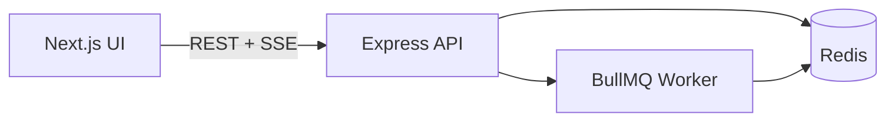

<p align="center">
  
</p>

<h1 align="center">QueueKit</h1>

<p align="center">
  <strong>Redis + BullMQ playground</strong> — explore caching and background jobs<br />
  with a live demo, then reuse the TypeScript toolkit in your own Node.js apps.
</p>

<p align="center">
  Built by <a href="https://asteriq.in">AsterIQ</a>
</p>

<p align="center">
  
  
  
  
  
  
</p>

---

## Purpose

QueueKit is a **learning playground** for Redis and BullMQ. It is built for developers who want to:

1. **See Redis in action** — keys, TTL, cache-aside, counters, rate limits, and pub/sub against a real Redis instance
2. **Understand background jobs** — enqueue BullMQ work, inspect job states, and watch a worker process them
3. **Reuse the infrastructure** — take the `@queuekit/*` packages into other Node.js services without rewriting connection, cache, or queue boilerplate

It is intentionally a demo and teaching surface — not a production job platform. Do not store secrets or real customer data in it.

---

## How it works

QueueKit is an **npm workspaces monorepo**. Three layers cooperate:

```text
  Browser (Next.js UI)
        │  REST + Server-Sent Events
        ▼
  Express API  ──►  BullMQ Worker (same process when RUN_WORKER=true)
        │                    │
        └────────┬───────────┘
                 ▼
              Redis
```

| Layer | Location | Responsibility |
| --- | --- | --- |
| **Web** | `frontend/` (`@queuekit/web`) | Redis Lab, Queue Studio, docs UI — talks to the API |
| **API + worker** | `backend/` (`@queuekit/api`) | HTTP routes, health, OpenAPI; optional in-process demo worker |
| **Toolkits** | `packages/` | Shared types and Redis/BullMQ helpers used by the API (and reusable elsewhere) |

**Request flow (queues):** UI → API enqueues a job → BullMQ stores it in Redis → worker picks it up → status updates stream back to the UI (SSE, with polling as fallback).

**Request flow (Redis Lab):** UI → API → namespaced Redis helpers in `@queuekit/redis-toolkit` → results returned to the UI.



### What you can explore

| Area | What it demonstrates |
| --- | --- |
| **Redis Lab** (`/playground`) | Keys, cache patterns, rate limiting, pub/sub |
| **Queue Studio** (`/queues`) | Job enqueue, states, worker activity |
| **API docs** (`/docs` on the API) | OpenAPI / Swagger for the HTTP surface |
| **Packages** | Drop-in Redis and queue primitives for other apps |

---

## Prerequisites

- **Node.js** `>= 20` ([`.nvmrc`](./.nvmrc))
- **npm** `10+`
- **Docker** — for local Redis (`docker compose`)

---

## Getting started

From the repository root:

```bash
# 1. Start Redis
docker compose up -d

# 2. Install dependencies (also builds @queuekit/* packages via postinstall)
npm install

# 3. Environment files
cp .env.example backend/.env
cp frontend/.env.example frontend/.env.local

# 4. Run the stack (two terminals)
npm run dev:backend     # API + worker → http://localhost:8000
npm run dev:frontend    # Web UI       → http://localhost:3000
```

| Endpoint | URL |
| --- | --- |
| Web UI | http://localhost:3000 |
| API health | http://localhost:8000/health |
| API docs | http://localhost:8000/docs |

### Environment

**Backend** — [`.env.example`](./.env.example) → `backend/.env`

| Variable | Purpose |
| --- | --- |
| `PORT` | API port (default `8000`) |
| `REDIS_URL` | Redis connection (`redis://127.0.0.1:6379` with Compose) |
| `CORS_ORIGIN` | Allowed frontend origin (`http://localhost:3000`) |
| `QUEUEKIT_API_HOST_URL` | API base URL for local use |
| `RUN_WORKER` | Set `true` so the demo worker runs with the API |

**Frontend** — [`frontend/.env.example`](./frontend/.env.example) → `frontend/.env.local`

| Variable | Purpose |
| --- | --- |
| `NEXT_PUBLIC_QUEUEKIT_API_URL` | API origin with no trailing slash |

---

## Common scripts

| Command | Description |
| --- | --- |
| `npm run dev:backend` | Start API (watch) + demo worker |
| `npm run dev:frontend` | Start Next.js dev server |
| `npm run build` | Build packages, API, and frontend |
| `npm run test` | Run backend and frontend tests |
| `npm run typecheck` | Typecheck all workspaces |
| `npm run lint` | Lint API and web |

---

## Repository layout

```text
QueueKit/
├── frontend/          # Next.js UI — Redis Lab, Queue Studio, docs
├── backend/           # Express API + demo BullMQ worker
├── packages/
│   ├── shared/        # Types, errors, shared constants
│   ├── redis-toolkit/ # Redis client + cache / counter helpers
│   └── queue-toolkit/ # BullMQ queue & worker helpers
├── docs/              # Product spec and deeper plans
├── docker-compose.yml # Local Redis 7
└── package.json       # Workspace root
```

| Package | Role |
| --- | --- |
| [`@queuekit/shared`](./packages/shared) | Types, error contracts, demo constants |
| [`@queuekit/redis-toolkit`](./packages/redis-toolkit) | Connection lifecycle and namespaced Redis helpers |
| [`@queuekit/queue-toolkit`](./packages/queue-toolkit) | Queue factory, worker helpers, retention defaults |

---

## Further reading

| Doc | Description |
| --- | --- |
| [Product & design spec](./docs/QUEUEKIT_PRODUCT_SPEC.md) | Goals, IA, and architecture decisions |
| [Backend plan](./backend/docs/PLAN.md) | API implementation notes |
| [Frontend plan](./frontend/docs/PLAN.md) | Web implementation notes |

---

<p align="center">
  <strong>QueueKit</strong> · Built by <a href="https://asteriq.in">AsterIQ</a>
</p>
